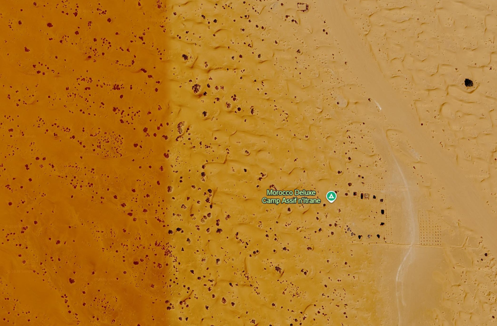

# analise-forense-terravision-evelyn-kauany

# 🌎 PROJETO TERRAVISION — ANÁLISE FORENSE E COMPUTAÇÃO GRÁFICA

## 1. IDENTIFICAÇÃO DO PROJETO

**Aluna:** Evelyn Kauany Lemes da Silva  
**Turma:** 3ºD — Ensino Médio Técnico em Desenvolvimento de Sistemas  
**Professora:** Angélica Neckel  
**Disciplina:** Desenvolvimento de Sistemas  
**Projeto:** Análise Analítica Forense e Computação Gráfica  
**Tema designado:** Zonas Desérticas e Camadas de Areia (Uniformes e Dunas)  
**Tecnologia utilizada:** Python, Git e GitHub  
**Repositório:** analise-forense-terravision-evelyn-lemes

---

## 2. APRESENTAÇÃO E CONTEXTUALIZAÇÃO

O projeto TerraVision está relacionado ao desenvolvimento de tecnologias de visualização geográfica, processamento de imagens de satélite e representação tridimensional do planeta Terra.

A proposta desta atividade é compreender como sistemas como TerraVision e Google Earth organizam grandes quantidades de informações geográficas para permitir que o usuário navegue pelo planeta, desde uma visão global até a visualização de detalhes específicos de uma determinada região.

Neste trabalho, o cenário analisado é o das **zonas desérticas e camadas de areia**, com atenção especial às superfícies uniformes e às formações de dunas.

As regiões desérticas apresentam características particulares, como grandes extensões de areia, variações de tonalidade, texturas provocadas pelo vento, sombras e diferentes formas de relevo.

A representação dessas características em imagens digitais exige técnicas de processamento, alinhamento, uniformização de cores e controle dos níveis de detalhamento.

O objetivo é relacionar esses conceitos à programação em Python e aos princípios de Computação Gráfica e UX/UI.

---

## 3. OBJETIVOS

### 3.1 Objetivo geral

Analisar a representação de zonas desérticas em sistemas de visualização geográfica, relacionando programação, processamento de imagens, computação gráfica e experiência do usuário.

### 3.2 Objetivos específicos

- Desenvolver uma função em Python para selecionar camadas de imagens de satélite conforme a altitude.
- Compreender o conceito de Level of Detail (LoD).
- Identificar dificuldades no processamento e na união de imagens de terrenos desérticos.
- Analisar características visuais das superfícies de areia e das formações de dunas.
- Identificar e explicar princípios das Leis da Gestalt.
- Compreender como o design da interface facilita a navegação e a interpretação das imagens.
- Relacionar o projeto aos conceitos apresentados na minissérie sobre a história do TerraVision e do Google Earth.

---

## 4. ETAPA 1 — CIÊNCIA DE DADOS E LÓGICA DE PROGRAMAÇÃO

### 4.1 Conceito de Level of Detail (LoD)

O Level of Detail, conhecido pela sigla LoD, é uma técnica utilizada em sistemas de visualização tridimensional para controlar o nível de detalhamento dos objetos e das imagens apresentados na tela.

Em sistemas como TerraVision e Google Earth, não é necessário carregar todas as imagens do planeta em alta resolução ao mesmo tempo. Isso exigiria uma quantidade muito grande de memória e processamento.

Por esse motivo, o sistema seleciona diferentes níveis de resolução conforme a altitude da câmera virtual.

Neste projeto, foram considerados três níveis:

| Altitude da câmera | Resolução | Representação |
|---|---|---|
| Acima de 10.000 metros | Baixa resolução | Mosaico geral da Terra |
| De 1.000 a 10.000 metros | Média resolução | Mosaico regional de zonas desérticas |
| Abaixo de 1.000 metros | Alta resolução | Detalhes das dunas, texturas e camadas de areia |

### 4.2 Desenvolvimento da função em Python

Foi desenvolvida a função `carregar_camada_satelite(lista_altitudes)`, que recebe uma lista de altitudes em metros e identifica o nível de renderização correspondente a cada valor.

A função utiliza estruturas condicionais `if`, `elif` e `else`, além de uma estrutura de repetição para percorrer os valores da lista.

As mensagens de retorno foram personalizadas de acordo com o tema designado: zonas desérticas e camadas de areia.

O código completo está disponível no arquivo [`script.py`](script.py).

### 4.3 Funcionamento esperado

**Baixa resolução — acima de 10.000 metros**

O sistema apresenta uma visão geral do planeta, permitindo localizar grandes regiões desérticas.

**Média resolução — entre 1.000 e 10.000 metros**

O sistema apresenta um mosaico regional com características gerais do deserto, permitindo observar a distribuição das áreas arenosas e das formações de dunas.

**Alta resolução — abaixo de 1.000 metros**

O sistema apresenta detalhes mais próximos do terreno, como curvas das dunas, diferenças de tonalidade, sombras e texturas da superfície arenosa.

### 4.4 Testes da função

Para verificar o funcionamento da lógica, foram utilizados diferentes valores de altitude, contemplando os três níveis de renderização.

Exemplos de valores para teste:

- 15.000 metros: baixa resolução.
- 10.000 metros: média resolução.
- 5.000 metros: média resolução.
- 1.000 metros: média resolução.
- 500 metros: alta resolução.
- 100 metros: alta resolução.

Os testes permitem verificar se a função classifica corretamente cada altitude, respeitando os limites definidos na atividade.

---

## 5. ETAPA 2 — COMPUTAÇÃO GRÁFICA E UX/UI

## 5.1 Processamento e tratamento de imagem

A representação de zonas desérticas em sistemas de visualização geográfica apresenta desafios específicos relacionados ao processamento e à união de imagens de satélite.

Um dos principais problemas é manter a uniformidade visual entre imagens capturadas em diferentes momentos ou condições de iluminação.

Mesmo quando duas imagens representam regiões próximas, podem existir diferenças de brilho, contraste, tonalidade e resolução. Essas diferenças podem gerar divisões perceptíveis entre os blocos de imagens.

No caso dos desertos, esse problema merece atenção porque grandes superfícies de areia apresentam tonalidades semelhantes. Uma pequena diferença de cor entre duas imagens pode produzir manchas artificiais e prejudicar a continuidade da paisagem.

### 5.1.1 Costura de imagens (Image Stitching)

O Image Stitching é o processo de unir diferentes imagens para formar uma representação visual contínua de uma região.

Nas zonas desérticas, esse processo enfrenta dificuldades como:

- Diferenças de iluminação entre imagens capturadas em horários distintos.
- Variações de tonalidade da areia.
- Dificuldade de identificar pontos de referência em superfícies muito uniformes.
- Desalinhamento entre imagens que representam áreas próximas.
- Interrupção visual das curvas e dos contornos das dunas.

As dunas possuem formatos irregulares e curvas naturais. Quando duas imagens não são alinhadas corretamente, essas formações podem parecer interrompidas ou deformadas.

Para reduzir esses problemas, é importante realizar o alinhamento das imagens, corrigir diferenças de brilho e contraste e ajustar as cores para criar uma transição mais natural entre os blocos.

### 5.1.2 Textura das camadas de areia

A textura é um elemento importante na identificação visual de terrenos desérticos.

As superfícies de areia podem apresentar regiões aparentemente uniformes, enquanto outras possuem marcas provocadas pela ação do vento, pequenas ondulações e diferenças de compactação.

Na visualização em alta resolução, esses detalhes ajudam a representar melhor as características do terreno.

Um desafio do processamento é preservar essas informações sem produzir ruídos visuais ou eliminar detalhes importantes durante a redução da resolução.

### 5.1.3 Uniformização de cores

A areia pode apresentar diferentes tonalidades dependendo da composição do solo, da iluminação e das condições ambientais.

Em uma mesma região, podem existir áreas mais claras, amareladas, alaranjadas ou avermelhadas.

Quando imagens diferentes são unidas, o algoritmo precisa ajustar essas variações para evitar mudanças bruscas de cor.

A uniformização é importante para manter a aparência natural da paisagem e evitar que o usuário perceba artificialmente os limites entre as imagens.

### 5.1.4 Iluminação e sombras das dunas

A iluminação solar influencia diretamente a aparência das formações de areia.

As dunas apresentam áreas iluminadas e regiões de sombra que ajudam a identificar suas curvas, inclinações e volumes.

Se o tratamento de iluminação não for adequado, os detalhes do relevo podem ficar menos perceptíveis, prejudicando a interpretação visual do terreno.

Por isso, o processamento precisa preservar os contrastes naturais entre áreas iluminadas e sombreadas.

---

## 5.2 Design de interface e Leis da Gestalt

As Leis da Gestalt são princípios utilizados para compreender como o cérebro humano organiza e interpreta informações visuais.

Em interfaces de visualização geográfica, esses princípios ajudam o usuário a identificar elementos, perceber relações espaciais e navegar de maneira mais intuitiva.

Neste projeto, foram selecionadas três leis da Gestalt relacionadas à representação de zonas desérticas.

### 5.2.1 Lei da Figura-Fundo

A Lei da Figura-Fundo explica como conseguimos distinguir um elemento principal do ambiente que está ao seu redor.

No contexto das zonas desérticas, as formações de dunas podem ser percebidas como elementos de destaque em relação às superfícies mais uniformes de areia.

As diferenças de iluminação, tonalidade e sombra ajudam o usuário a identificar os contornos das dunas e compreender sua distribuição no terreno.

**Aplicação no projeto:** destacar visualmente as formações de dunas em relação às áreas de areia uniforme, facilitando a interpretação da paisagem.

### 5.2.2 Lei da Continuidade

A Lei da Continuidade está relacionada à tendência de perceber linhas e formas como sequências contínuas.

Nas imagens de regiões desérticas, esse princípio pode ser observado na continuidade das curvas e dos contornos das dunas.

Quando diferentes imagens de satélite são alinhadas corretamente, as formações naturais mantêm sua continuidade visual, permitindo que o usuário acompanhe suas formas sem interrupções.

**Aplicação no projeto:** preservar o alinhamento entre imagens e permitir que o usuário acompanhe visualmente as curvas das dunas durante a aproximação do zoom.

### 5.2.3 Lei da Proximidade

A Lei da Proximidade explica que elementos posicionados próximos uns dos outros tendem a ser percebidos como pertencentes ao mesmo grupo.

Em uma interface de visualização geográfica, informações relacionadas podem ser organizadas em áreas próximas, facilitando sua compreensão.

Por exemplo, os controles de zoom, orientação e navegação podem ficar agrupados, enquanto as informações sobre a localização e a escala podem ser apresentadas em uma área específica da interface.

**Aplicação no projeto:** organizar os controles e as informações geográficas de forma lógica, facilitando a navegação durante a análise das zonas desérticas.

---

## 5.3 Design gráfico e experiência do usuário (UX/UI)

A experiência do usuário, conhecida como UX (User Experience), está relacionada à facilidade, à eficiência e à satisfação durante a utilização de um sistema.

Já a interface do usuário, ou UI (User Interface), envolve os elementos visuais e interativos com os quais o usuário tem contato.

Em sistemas como Google Earth, o design gráfico possui papel importante porque permite que o usuário explore diferentes regiões do planeta sem precisar compreender diretamente os processos técnicos de processamento de imagens.

### Como o design orienta a atenção do usuário?

O design gráfico pode orientar a atenção por meio de:

- Controles de zoom que permitem aproximar e afastar a visualização.
- Organização dos elementos de navegação.
- Contraste entre os controles e o mapa.
- Indicadores de orientação e localização.
- Apresentação gradual de detalhes conforme a aproximação da câmera.
- Organização visual das informações geográficas.

### Como isso facilita a navegação nas zonas desérticas?

Quando o usuário procura uma região desértica, ele pode começar com uma visão ampla do planeta e aproximar gradualmente a câmera até localizar o terreno desejado.

A mudança progressiva de resolução permite observar primeiro a localização geral do deserto, depois suas características regionais e, finalmente, detalhes das dunas e das superfícies de areia.

Essa organização facilita a navegação e evita que o usuário receba informações excessivas de uma só vez.

Portanto, uma interface bem organizada contribui para uma experiência mais intuitiva, permitindo explorar a paisagem de maneira clara e eficiente.

---

## 6. IMAGENS E EVIDÊNCIAS DO TEMA

A análise visual é importante para compreender como as zonas desérticas são representadas em imagens digitais.

### 6.1 Imagem ilustrativa do cenário desértico

A imagem a seguir representa uma paisagem desértica e serve como referência visual para observar características como tonalidade, relevo, textura e formações naturais.


## Paisagem do Deserto do Saara

### 6.2 Captura de tela do Google Earth

**Evidência obrigatória da atividade:**

Nesta seção deve ser inserida pelo menos uma captura de tela realizada diretamente no Google Earth, mostrando uma região desértica mapeada.

A captura deve permitir visualizar a região escolhida e demonstrar a aplicação prática do tema estudado.

**Região sugerida para análise:** Deserto do Saara, localizado no norte do continente africano.

**Inserir a captura de tela abaixo:**



*Figura 2 — Visualização de uma região desértica no Google Earth.*

---

## 7. RELAÇÃO COM A MINISSÉRIE — A BATALHA BILIONÁRIA: O CASO GOOGLE EARTH

A minissérie apresenta a história relacionada ao desenvolvimento do TerraVision pela empresa alemã ART+COM e a disputa de propriedade intelectual envolvendo o Google Earth.

A produção permite compreender a importância da inovação tecnológica, da organização dos dados geográficos e do desenvolvimento de algoritmos capazes de processar e apresentar grandes quantidades de imagens.

O projeto desenvolvido nesta atividade possui relação direta com esses conceitos, pois utiliza programação para simular a seleção de imagens de satélite conforme a altitude da câmera virtual.

### 7.1 Relação com o episódio 1 — A ideia e o protótipo

O primeiro episódio apresenta a origem do TerraVision, a criação da interface visual e a organização inicial dos dados geográficos.

A relação com este trabalho está na importância de transformar informações geográficas em uma representação visual navegável.

No tema desértico, isso significa organizar imagens de satélite para permitir a identificação das regiões de areia e das formações de dunas.

### 7.2 Relação com o episódio 2 — A apresentação e o algoritmo

O segundo episódio aborda a otimização do processamento, o uso de arrays e a seleção de informações conforme o nível de aproximação.

Esses conceitos estão relacionados à função desenvolvida em Python, que percorre uma lista de altitudes e seleciona o nível de resolução adequado.

A utilização de diferentes níveis de detalhamento permite reduzir o processamento desnecessário e apresentar informações de acordo com a aproximação da câmera.

### 7.3 Relação com o episódio 3 — O lançamento do Google Earth e o plágio

O terceiro episódio apresenta o surgimento do Google Earth e a discussão envolvendo a arquitetura tecnológica dos sistemas de visualização geográfica.

A relação com o projeto está na importância da organização das imagens, da padronização visual e da experiência do usuário.

A representação das zonas desérticas depende de imagens bem organizadas e de uma transição visual coerente entre diferentes níveis de resolução.

### 7.4 Relação com o episódio 4 — O julgamento do tribunal de patentes

O quarto episódio aborda a disputa judicial, a análise técnica de códigos e a importância da perícia computacional.

A relação com a atividade está na necessidade de compreender e justificar a lógica utilizada no código.

A função desenvolvida apresenta estruturas condicionais que determinam qual camada deve ser carregada conforme a altitude, permitindo analisar o comportamento do algoritmo de maneira organizada e verificável.

---

## 8. CONCLUSÃO

O desenvolvimento do projeto TerraVision permitiu compreender a relação entre programação, ciência de dados, computação gráfica e experiência do usuário.

A implementação da função em Python demonstrou como estruturas condicionais e estruturas de repetição podem ser utilizadas para selecionar diferentes níveis de resolução conforme a altitude da câmera virtual.

A análise das zonas desérticas mostrou que a representação de grandes superfícies de areia exige atenção especial ao alinhamento das imagens, à uniformização de cores, à preservação das texturas e à continuidade das formações de dunas.

Também foi possível compreender como as Leis da Gestalt contribuem para a interpretação visual e como os princípios de UX/UI facilitam a navegação em sistemas de visualização geográfica.

Por fim, a relação com a minissérie demonstrou a importância do desenvolvimento de algoritmos, da organização de dados e da análise técnica na construção de tecnologias como TerraVision e Google Earth.

Conclui-se que a atividade possibilitou aplicar conhecimentos de Desenvolvimento de Sistemas em um cenário prático, relacionando lógica de programação e conceitos visuais à representação digital do planeta.

---

## 9. ESTRUTURA DO REPOSITÓRIO

A organização dos arquivos do projeto está planejada da seguinte maneira:

```text
analise-forense-terravision-evelyn-lemes/
│
├── README.md
├── script.py
├── deserto-saara.png
└── google-earth-deserto.png
```

**Descrição dos arquivos:**

- `README.md`: documentação do projeto, identificação, análise técnica, respostas da Etapa 2, imagens e histórico de commits.
- `script.py`: código Python com a função de seleção das camadas de imagens conforme a altitude.
- `deserto-saara.png`: imagem ilustrativa complementar do tema.
- `google-earth-deserto.png`: captura de tela realizada diretamente no Google Earth.

---

## 10. HISTÓRICO DE VERSIONAMENTO — GIT E GITHUB

O Git é um sistema de controle de versão utilizado para registrar alterações realizadas nos arquivos de um projeto.

O GitHub permite armazenar o repositório remotamente, acompanhar as modificações e compartilhar o desenvolvimento.

Para manter a organização do projeto, os commits devem apresentar mensagens claras e relacionadas às alterações realizadas.

### Histórico de commits sugerido

As mensagens abaixo são exemplos de registros que podem ser utilizados durante o desenvolvimento:

| Etapa | Mensagem do commit | Alteração |
|---|---|---|
| 1 | `docs: cria estrutura inicial do projeto` | Criação do README.md |
| 2 | `feat: implementa funcao de camadas via altitude` | Desenvolvimento do script.py |
| 3 | `test: adiciona testes de altitude` | Verificação dos níveis de resolução |
| 4 | `docs: adiciona analise de zonas deserticas` | Documentação do processamento de imagens |
| 5 | `docs: adiciona leis da Gestalt e UX UI` | Complementação da análise visual |
| 6 | `assets: adiciona imagens do projeto` | Inclusão das imagens ilustrativas e evidências |

*Observação: o histórico real de commits deve ser consultado na aba de commits do GitHub. Os exemplos acima são sugestões de mensagens e não representam registros já realizados.*

---

## 11. REFERÊNCIAS E MATERIAIS DE APOIO

- Material didático da atividade prática individual: Análise Analítica Forense e Computação Gráfica.
- Minissérie: A Batalha Bilionária: O Caso Google Earth.
- Interface do Google Earth, utilizada como referência para observação de imagens e navegação geográfica.
- Conteúdos estudados em Ciência de Dados, Lógica de Programação, Computação Gráfica e UX/UI.

---

## 12. AUTORIA

**Evelyn Kauany Lemes da Silva**

Estudante do 3ºD — Ensino Médio Técnico em Desenvolvimento de Sistemas.

Projeto individual desenvolvido para a atividade de Análise Analítica Forense e Computação Gráfica, sob orientação da professora Angélica Neckel.

**Tema:** Zonas Desérticas e Camadas de Areia (Uniformes e Dunas).

---
