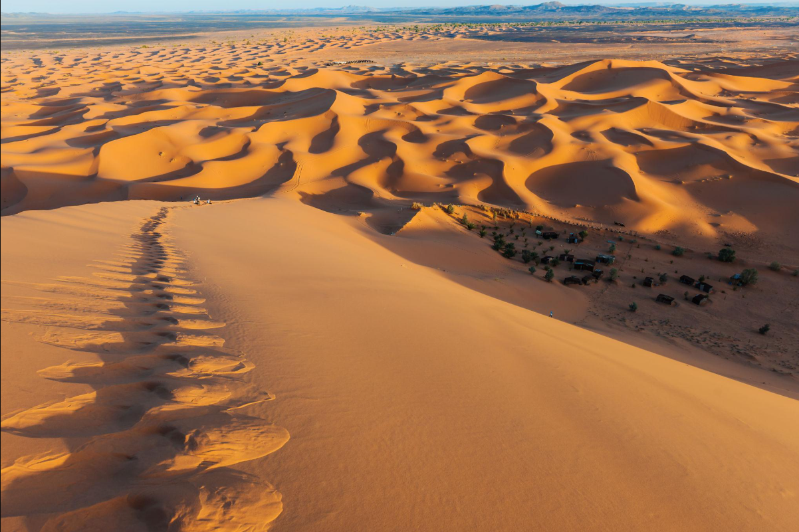
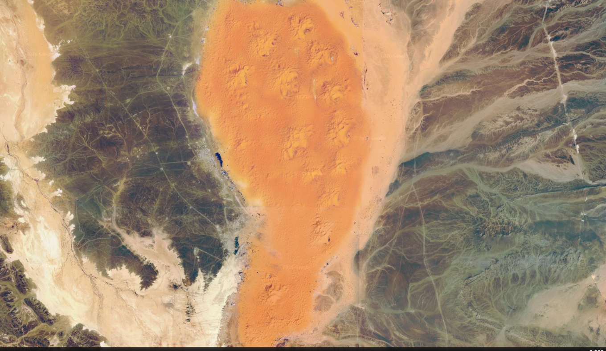

# ANÁLISE FORENSE TERRAVISION — ZONAS DESÉRTICAS E CAMADAS DE AREIA

## 1. IDENTIFICAÇÃO

- **Aluna:** Evelyn Kauany Lemes da Silva
- **Turma:** 3ºD
- **Curso:** Desenvolvimento de Sistemas
- **Professora:** Angélica Neckel
- **Projeto:** TerraVision
- **Tema:** Zonas Desérticas e Camadas de Areia (Uniformes e Dunas)
- **Local de estudo:** Erg Chebbi, Marrocos — deserto do Saara
- **Tecnologias utilizadas:** Python, Git e GitHub

---

## 2. APRESENTAÇÃO DO PROJETO

O projeto TerraVision tem como objetivo estudar e representar visualmente uma região desértica, utilizando como referência Erg Chebbi, localizado próximo a Merzouga, no Marrocos, no deserto do Saara.

A proposta envolve a análise das características das paisagens desérticas, como superfícies arenosas, camadas de areia, formações de dunas, texturas, cores e sombras.

O trabalho relaciona esses elementos aos conceitos de programação, computação gráfica, visualização geográfica e experiência do usuário.

Também busca compreender como ferramentas digitais, como o Google Earth, permitem observar diferentes regiões da superfície terrestre por meio de imagens geográficas.

## 3. OBJETIVOS

### 3.1 Objetivo geral

Desenvolver uma análise visual e computacional de uma região desértica, explorando características das superfícies arenosas e formações de dunas por meio de conceitos de programação e computação gráfica.

### 3.2 Objetivos específicos

- Identificar características das regiões desérticas.
- Observar a formação e a distribuição das dunas.
- Utilizar Erg Chebbi, no Marrocos, como região de referência.
- Analisar imagens geográficas por meio do Google Earth.
- Compreender o conceito de Image Stitching.
- Aplicar o conceito de Level of Detail (LOD).
- Relacionar programação Python e análise visual.
- Aplicar conceitos de computação gráfica e UX/UI.
- Organizar os arquivos utilizando Git e GitHub.

## 4. PROGRAMAÇÃO PYTHON E NÍVEIS DE DETALHAMENTO (LOD)

O projeto utiliza a linguagem Python para simular a seleção de diferentes níveis de detalhamento (Level of Detail — LOD), de acordo com a altitude de uma câmera virtual.

Foi desenvolvida a função `carregar_camada_satelite()`, responsável por receber uma lista de altitudes, validar os valores e selecionar o nível de resolução correspondente.

O código trabalha com três níveis de detalhamento:

- **Baixa resolução:** utilizada em altitudes acima de 10.000 metros, representando uma visualização geral de grandes regiões desérticas.
- **Média resolução:** utilizada em altitudes de 1.000 até 10.000 metros, representando a distribuição das áreas arenosas e das formações de dunas.
- **Alta resolução:** utilizada em altitudes abaixo de 1.000 metros, representando detalhes das dunas, ondulações, texturas e sombras da superfície.

O programa utiliza os seguintes recursos da linguagem Python:

- Funções para organizar a execução do código.
- Estruturas condicionais (`if`, `elif` e `else`).
- Estruturas de repetição (`for`).
- Listas para armazenar os resultados.
- Validação de dados para evitar entradas inválidas.

O código realiza testes com seis altitudes diferentes, apresentando os níveis de resolução selecionados para cada valor.

Essa implementação demonstra, de forma simplificada, como o conceito de LOD pode ser aplicado à organização da visualização de informações geográficas.

**Observação:** o script simula a seleção dos níveis de resolução. Ele não realiza o carregamento de imagens reais do Google Earth nem a renderização de mosaicos de satélite.

## 5. COMPUTAÇÃO GRÁFICA E REPRESENTAÇÃO VISUAL

A computação gráfica está relacionada à representação visual das paisagens e à organização das imagens utilizadas no projeto.

Na análise das regiões desérticas, alguns elementos importantes são:

- **Textura:** representação visual da areia e de suas diferentes superfícies.
- **Iluminação:** influência da luz solar na aparência das dunas.
- **Sombras:** ajudam a identificar o relevo e o formato das formações de areia.
- **Cores:** permitem observar as variações entre as áreas arenosas.

### 5.1 Image Stitching

Image Stitching é uma técnica utilizada para unir duas ou mais imagens que possuem áreas em comum, formando uma imagem panorâmica ou uma representação visual mais ampla.

No contexto do TerraVision, esse conceito está relacionado à composição de imagens geográficas, permitindo compreender como diferentes registros visuais podem formar uma representação contínua de uma paisagem.

### 5.2 Leis da Gestalt

As leis da Gestalt ajudam a compreender como os elementos visuais são percebidos e organizados.

- **Figura e fundo:** diferenciação das dunas em relação ao ambiente ao redor.
- **Continuidade:** percepção das linhas e curvas formadas pelas dunas.
- **Proximidade:** identificação de elementos visuais que estão próximos uns dos outros.

### 5.3 UX/UI

Os conceitos de UX (Experiência do Usuário) e UI (Interface do Usuário) estão relacionados à facilidade de utilização, à organização das informações e à apresentação visual de um sistema.

No contexto do TerraVision, esses conceitos ajudam a compreender como a organização das imagens, a navegação e os recursos de aproximação facilitam a observação e a compreensão das paisagens geográficas.

## 6. IMAGENS E REGISTROS VISUAIS

As imagens utilizadas no projeto têm como referência a região de Erg Chebbi, no Marrocos, conhecida por suas grandes formações de dunas no deserto do Saara.

### 6.1 Imagem ilustrativa das dunas

Registro visual das dunas de Erg Chebbi, localizadas no deserto do Saara, em Marrocos.

### 6.2 Registro do Google Earth

Visualização por satélite de Erg Chebbi, em Marrocos, utilizada para observar as características e a extensão da área desértica.

As duas imagens possuem finalidades diferentes: a imagem ilustrativa destaca as características visuais das dunas, enquanto o registro do Google Earth apresenta a referência geográfica da região estudada.

## 7. RELAÇÃO COM A MINISSÉRIE A BATALHA BILIONÁRIA: O CASO GOOGLE EARTH

A minissérie *A Batalha Bilionária: O Caso Google Earth* apresenta uma disputa envolvendo tecnologia, imagens de satélite e ferramentas de visualização geográfica.

A produção permite relacionar o desenvolvimento de tecnologias digitais com a importância da representação visual de diferentes regiões do planeta.

O projeto TerraVision se conecta a esse contexto ao explorar conceitos de visualização geográfica, imagens digitais e representação de paisagens terrestres.

## 8. CONCLUSÃO

A realização deste projeto possibilitou compreender melhor como a tecnologia pode ser utilizada para observar, analisar e representar diferentes paisagens terrestres.

Utilizando Erg Chebbi, no Marrocos, como referência, foi possível explorar características das zonas desérticas, como as camadas de areia, as formações de dunas, as texturas e as variações de iluminação.

O desenvolvimento do código em Python permitiu aplicar conceitos de programação, como funções, estruturas condicionais, repetição e validação de dados, simulando a seleção de níveis de detalhamento conforme a altitude.

O trabalho também possibilitou relacionar conhecimentos de computação gráfica, Image Stitching, Gestalt, UX/UI e ferramentas digitais, demonstrando a importância da tecnologia na análise e visualização de imagens geográficas.

## 9. ORGANIZAÇÃO DO REPOSITÓRIO

Os arquivos do projeto estão organizados no GitHub para facilitar a visualização, o acesso e o acompanhamento do desenvolvimento.

Estrutura do projeto:

- `README.md` — documentação e apresentação do projeto.
- `script.py` — código-fonte em Python responsável pela simulação dos níveis de detalhamento.
- `imagem-ilustrativa.png` — imagem de referência das dunas.
- `google-earth-deserto.png` — registro da região observado no Google Earth.

**Observação:** os nomes dos arquivos devem corresponder exatamente aos nomes utilizados no repositório.

## 10. GIT E GITHUB

O Git foi utilizado como ferramenta de controle de versão, permitindo acompanhar as alterações realizadas durante o desenvolvimento.

O GitHub foi utilizado para armazenar o projeto remotamente, organizar seus arquivos e disponibilizar a documentação.

## 11. REFERÊNCIAS

- Google Earth — ferramenta de visualização geográfica e imagens de satélite.
- Python — documentação oficial da linguagem de programação.
- Git — sistema de controle de versão.
- GitHub — plataforma de hospedagem e organização de projetos.
- Minissérie *A Batalha Bilionária: O Caso Google Earth*.

## 12. AUTORIA

Projeto desenvolvido por **Evelyn Kauany Lemes da Silva**, estudante do 3ºD do curso de Desenvolvimento de Sistemas, como atividade escolar.

**Tema:** Zonas Desérticas e Camadas de Areia (Uniformes e Dunas).

**Local de referência:** Erg Chebbi, Marrocos — deserto do Saara.
